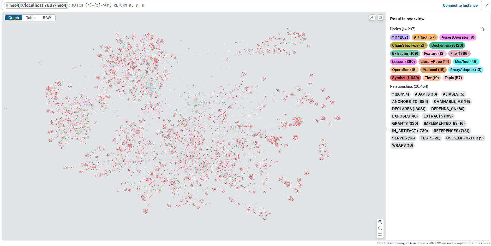

# neoize



Turn a codebase and the hard-won knowledge around it into a local Neo4j graph that Claude queries by
relevance, instead of a wiki nobody reads and a CLAUDE.md that grows until nobody can find anything in
it.

neoize is a Claude Code plugin. You install it, run one setup command in your project, and point it at
the notes you already have. From then on Claude pulls the handful of lessons that touch the code it is
editing, and a hook reminds it of the traps at the moment a risky operation fires.

## The idea

Most projects accumulate two kinds of knowledge that a long Markdown file serves badly:

- **Lessons.** The gotchas, conventions and rules a maintainer learned the expensive way. In a flat
  file they are read wholesale or not at all, and a note about a renamed symbol rots in place with
  nothing to flag it.
- **Structure.** What the project is made of and how a change propagates: modules, services, routes,
  whatever the domain's nouns are, and the edges between them.

neoize puts both in a graph. A lesson is **anchored** to the thing it concerns, a topic, a decision
point, or a structural node, so it is retrieved when that thing is in play rather than scrolled past.
The conceptual model is BloodHound: a collector reads the source, Neo4j holds it, Cypher answers the
path questions (what depends on this, which lessons touch what I am editing, what bites when I push).

The graph has two layers, and they are deliberately different in how portable they are:

- The **knowledge layer** (Topics, Operations, Lessons) is generic. It works with no code parsing at
  all, so you get value the moment you migrate your existing notes.
- The **structural layer** is yours. What counts as structure is your domain, so neoize does not ship a
  universal extractor that would fit nowhere. Instead the setup skill reads your code and proposes a
  collector for you to approve.

## Products and modes

Every node in the graph carries a **product** discriminant, a short name for the product it belongs to.
That is what lets one Neo4j hold more than one product at once without their nodes running into each
other. A product can span several repos: give each repo's `.neoize/project.json` the same product id and
they feed one graph. The id defaults to the repo name; `neoize product --set` changes it.

One product id is reserved: **`shared`**, the universal layer. It holds the knowledge that is true for all
your work with Claude, independent of any one codebase: how you run git, how a PR is opened, verification
discipline, the voice your writing uses. It lives in the global server, so in **global mode** a session
**reads the union** of `shared` and its own product, with universal wisdom always in view and a project's
own lessons complementing it. A session **writes** to a single product; a lesson that turns out to be
universal is promoted up to `shared` with `/neoize:promote`, where every other project then reads it.
Structure and symbols are never shared, because they are one codebase's own.

Because the discriminant is in the data, you choose at setup how the server is run. It is only a
lifecycle choice:

- **global** (the default) runs one shared Neo4j for the whole machine, at `~/.neoize/`. Every product you
  set up lives in it alongside the `shared` layer, kept apart by the discriminant, so a session reads the
  shared+project union. This is the mode to pick for a shared baseline of wisdom across your products.
- **project** gives a project its own Neo4j, its own container and volume and ports. The graph is
  self-contained: it holds only that one product, with no shared layer. Pick it when a graph must stay
  isolated (a client repo you keep apart). It is still product-stamped, so its data stays compatible.

## Install

Prerequisites, both of which you very likely already have:

- Docker, with the daemon running. The graph is a local Neo4j container, bound to loopback only.
- `python3`.

That is the whole list. The read-only MCP server Claude queries the graph through is **bundled in the
plugin** (`scripts/neoize-mcp`, pure standard library, it reaches the graph through the container), so
there is nothing to `pip`, `uv` or `pipx` first.

Then, in Claude Code:

```
/plugin marketplace add foobar-beer/claude-neoize
/plugin install neoize@foobar-beer
```

Restart Claude Code once after installing, so the bundled MCP server registers.

### Connection

neoize talks to one local Neo4j container over loopback. The connection (container name, user,
password) is set through the plugin's own options, which Claude Code asks for when you enable the
plugin and stores for you. All three have working defaults that match the shipped compose, so a
standard local setup needs no input. The password defaults to a local throwaway and is marked
sensitive, so a real one you set is kept in Claude Code's secure store rather than a settings file.
Nothing is read from an ambient environment variable: the value the MCP server and the hook use is the
one you configured. For a terminal run of the CLI outside the plugin you can still export the
`NEOIZE_NEO4J_*` variables yourself.

The product and the mode are a per-project choice, not a plugin option, so they live in
`.neoize/project.json` (which `init` writes and you version-control) rather than in the plugin settings.
In project mode the container the tools reach is `neoize-<product>`, derived from that file; in global
mode it is the configured `neoize-neo4j`.

## Quick start

In the project you want a graph for:

```
/neoize:init       # brings up the graph, scaffolds .neoize/, proposes a structural schema
/neoize:migrate    # moves your existing CLAUDE.md / docs / notes into lessons
```

`init` sets up `.neoize/` in your repo (you version-control it), has you confirm the product id and the
server mode, starts Neo4j and walks you through proposing the structural schema for your codebase. The new
project reads the machine's `shared` layer from the start, so it does not begin empty. `migrate` reads the
prose knowledge you already have, sorts it into lessons anchored to topics and operations, loads it, and
replaces each migrated block with a one-line pointer so the same fact never lives in two places.

Ask the graph anything through the MCP server once it is up, for example "pull the lessons on the proxy
subsystem" or "what breaks if I change this module".

## How it works

**The knowledge layer.** Lessons are authored as JSON in `.neoize/lessons/*.json`, one file per theme,
validated by `templates/lesson.schema.json`. A loader merges them into Neo4j and validates every
anchor, so a lesson that points at a node which does not exist is reported and skipped, never
fabricated. Lessons are authored in the JSON and loaded, never hand-edited in the database, because a
reload would lose the edit.

**The operation hook.** A PreToolUse hook maps a tool call to an operation id through
`.neoize/triggers.json` (a git push, a release, closing a ticket) and pulls that operation's lessons the
moment it fires, so the reminder does not depend on anyone remembering to look. It never blocks and
fails open: no graph, no Docker, or a slow query never interrupts the session. Finding zero lessons on
an operation is the expected case and is fine.

**The structural layer.** `.neoize/collect.py`, the per-project collector the setup proposes, reads your
build files and registries and writes `.neoize/graph.json` plus a Cypher form. It is a projection:
regenerate it, never hand-edit it. The small JSON is committed and diffable; a large symbol dump, if you
add one, is a rebuildable artifact and stays out of git.

## The control surface: MCP tools

The bundled MCP server (`scripts/neoize-mcp`) is the control surface. A Claude or MCP session drives the
whole graph by calling tools, with nothing on PATH and no script for the human to run:

- `read_neo4j_cypher`, `get_neo4j_schema`: query the graph and read its shape (read-only). `$products`, the
  shared+project read union, is pre-bound, so a read scopes with `WHERE n.product IN $products`. A read of a
  Lesson/Topic/Operation that is not scoped by product is refused (pass `cross_space` to override).
- `graph_status`, `graph_up`, `graph_down`: report on, start, or stop the graph.
- `load_lessons`, `load_graph`, `rebuild_structure`: load the lessons, load the structure, or regenerate
  the structure from the code.
- `check_lessons`, `check_graph`: the offline validations.
- `sync_queries`: re-sync `.neoize/queries` from the plugin templates (queries only; dry by default).
- `promote_lessons`: move a project lesson up into the universal `shared` layer.
- `load_shared`: load the universal lessons store into product=shared.

The query tool is read-only (a write clause is refused). The control tools are explicitly mutating, and
the host gates each tool call, so a write still asks.

### The same operations as a CLI (optional, for a terminal)

`scripts/neoize` is the exact CLI the tools wrap, kept for a human in a terminal or a non-MCP context:

```
neoize up                 # start the Neo4j (shared ~/.neoize in global mode, the project's own in project mode)
neoize down [--wipe]      # stop it; --wipe also drops the data volume
neoize status             # is it up, the shared+project counts this session reads and the roster
neoize load-lessons [p]   # load authored lessons (default .neoize/lessons); --prune drops removed ones
neoize load-graph <file>  # load the collector's .cypher, resetting only this product's structural layer
neoize shared load        # load the universal store (~/.neoize/shared/lessons) into product=shared
neoize check [path]       # validate lessons files locally, before they touch the graph
neoize sync-queries       # re-sync .neoize/queries from the plugin templates (queries only; --write to apply)
neoize query "<cypher>"   # run one Cypher query ($product and $products are bound for scoping)
neoize product [--set ID] [--mode global|project]   # print or set the product and mode
neoize promote --lessons a,b,c   # move project lessons up into the shared (universal) layer
```

For a terminal run outside Claude Code the connection comes from the environment, with local defaults
matching the shipped compose: `NEOIZE_NEO4J_CONTAINER` (neoize-neo4j), `NEOIZE_NEO4J_USER` (neo4j),
`NEOIZE_NEO4J_PASSWORD` (neoize-local). `NEOIZE_PRODUCT` overrides the resolved product and `NEOIZE_HOME`
the shared server location. Inside the plugin the connection comes from the options you configured
instead. The password is a local loopback throwaway, not a secret.

## Keeping it fresh

Run `/neoize:refresh` after changing the code's structure, after editing lessons, or when a fix makes a
lesson stale. It rebuilds the structural projection, reloads the lessons (a structural reload drops the
lesson-to-structure anchors, so a lesson reload always follows it), and helps you reconcile lessons that
describe now-fixed behaviour. A fixed bug leaves its description behind, and a note stating a fixed
mechanism in the present tense goes false while nothing errors, so reconciling on a close is part of the
loop, not an afterthought.

Run `/neoize:wrap` at the end of a session. It decides what the session learned and routes each fact to
its one home: a situational gotcha becomes a lesson in the graph, a durable rule goes to the always-on
rules file, history goes to the changelog, session state goes to agent memory. The homes other than the
graph are named in `.neoize/wrap.md`, which `init` scaffolds for you. The rule it enforces is that each
fact lives in exactly one place, because a fact written twice drifts and the stale copy gets cited with
confidence.

## Upgrading an existing graph

A graph built before the product discriminant has nodes with no product on them and a collector that
emits `{id:...}` keys. Upgrading is safe, because the graph is only a projection of your files: you wipe
it and rebuild under the new code; nothing authored is lost (lessons are the JSON files, structure
comes from the collector). Per project:

1. Install this version and restart Claude Code so the new MCP server registers.
2. Write `.neoize/project.json` with `neoize product --set <id> --mode <global|project>`. To keep running
   the project's existing container under project mode, add its name: `{"product":"<id>", "mode":"project",
   "container":"<existing-container>"}`. To consolidate into one shared server instead, use `global`.
3. Update the collector so every MERGE key carries the product: change its emit to
   `{product:$product, id:...}`. `neoize load-graph` refuses the old `{id:...}` form, which is the reminder
   if you forget.
4. Rebuild clean. In project mode: `neoize down --wipe`, `neoize up`, then `neoize load-graph` and
   `neoize load-lessons`. In global mode: `neoize up` (the shared server), then the same two loads; once
   `neoize status` shows the product, retire the old per-project container and its volume.
5. Separate the universal half. Knowledge that holds for every project (git discipline, PR flow,
   verification, writing voice) belongs in the `shared` layer, not in a product: `neoize promote --lessons
   <ids>` moves those lessons into `~/.neoize/shared/lessons`, then `neoize shared load` loads them as
   product=shared. Every project then reads them on top of its own. Hold a high bar; when in doubt, leave a
   lesson in its project.

`neoize status` then shows the shared+project union this session reads and the roster of products on the
server.

## What is generic and what you bring

Generic, shipped, works anywhere: the lesson schema and loader, the operation hook, the Neo4j compose
and MCP wiring, the retrieval queries, the whole Topic and Operation model.

Yours, proposed per project: the structural schema and its collector, the lessons themselves, and the
trigger table that names your operations. A language-aware symbol layer (every function and its resolved
callers) is out of scope for v1, because it is the one piece that does not generalize cheaply. The setup
can scope it as a follow-up if you want it.

## Layout

```
.claude-plugin/plugin.json        plugin manifest
.claude-plugin/marketplace.json   marketplace entry
skills/neoize-init/               set up a project (product id, mode, schema)
skills/neoize-migrate/            move existing notes into lessons
skills/neoize-refresh/            keep the graph current
skills/neoize-wrap/               end-of-session capture: route what was learned to its one home
skills/neoize-promote/            move a project lesson up into the shared (universal) layer
skills/neoize-cypher-help/        print example Cypher tailored to this graph, for the Neo4j Browser
hooks/hooks.json                  PreToolUse registration
hooks/graph-operation-reminder.py the operation reminder (triggers are data, in your .neoize/)
scripts/neoize                    the CLI
scripts/load-lessons              the lesson loader
scripts/neoize-mcp                the bundled read-only Neo4j MCP server (no dependency)
templates/                        compose, schemas, example lessons, triggers, project, saved queries
.mcp.json                         registers the bundled MCP server
```

## License

MIT.
